# Car Rental Management System

A Windows desktop application written in **C++17** using the **native Win32 API and Common Controls**.
It does not use Qt, MFC, C++/CLI or any third-party library.
It builds with a default Visual Studio 2022 "Desktop development with C++" installation.

It manages a fleet of rental vehicles. You can add and edit vehicles, search for available ones by model, rent and return vehicles (the return prints a receipt) and track the cumulative rental revenue. All data is stored in UTF-8 text files next to the `.exe`.

---

## 1. Project structure

```
Car_Rental_Management_System/
├── CarRentalSystem.sln              ← open this in Visual Studio 2022
├── README.md                        ← this file (setup, OOP explanation, UML)
├── TEST_CHECKLIST.md                ← step-by-step demonstration / test plan
└── CarRentalSystem/
    ├── CarRentalSystem.vcxproj      ← project (C++17, Unicode, /W4, Windows subsystem)
    ├── CarRental.rc, Resource.h     ← menu, accelerators, dialog templates, version info
    │
    │   Business logic (no GUI code)
    ├── Money.h/.cpp                 ← value class, integer cents
    ├── Renter.h/.cpp                ← name + phone, validated
    ├── Rental.h/.cpp                ← Renter + agreed rate, calculateCharge()
    ├── Receipt.h/.cpp               ← data of a completed rental
    ├── Vehicle.h/.cpp               ← plate, model, rate, status, optional<Rental>
    ├── RentalAgency.h/.cpp          ← owns the fleet + revenue, one method per use case
    ├── RentalExceptions.h/.cpp      ← exception hierarchy
    ├── Validation.h/.cpp            ← all validation rules in one place
    ├── TextUtils.h/.cpp             ← trimming, case-insensitive compare, UTF-8
    ├── BusinessRuleSelfTest.h/.cpp  ← Help > Run Business Rule Self-Test
    │
    │   Persistence
    ├── IDataStore.h/.cpp            ← abstract interface (pure virtual load/save)
    ├── TextFileDataStore.h/.cpp     ← vehicles.txt / revenue.txt implementation
    ├── InMemoryDataStore.h/.cpp     ← second implementation (used by the self-test)
    │
    │   GUI
    ├── main.cpp                     ← wWinMain: wires the layers together
    ├── MainWindow.h/.cpp            ← menu, tabs, lists, status bar
    ├── ModalDialog.h/.cpp           ← abstract base class of all dialogs
    ├── AddEditVehicleDialog.h/.cpp
    ├── RentDialog.h/.cpp
    ├── ReturnDialog.h/.cpp
    ├── ReportListView.h/.cpp        ← sortable, coloured ListView wrapper
    ├── GuiUtils.h/.cpp              ← fonts (RAII), DPI scaling, helpers
    ├── Win32Include.h
    │
    └── data/
        ├── vehicles.txt             ← sample fleet (8 vehicles)
        ├── revenue.txt              ← sample revenue (3250.00)
        └── vehicles_with_errors.txt ← for demonstrating load validation
```

---

## 2. Building and running in Visual Studio 2022

### Option A: open the included solution (recommended)

1. Install **Visual Studio 2022** with the **"Desktop development with C++"** workload. The default components are enough: MSVC v143 and a Windows 10/11 SDK.
2. Double-click **`CarRentalSystem.sln`**.
3. Choose the configuration **Debug** and the platform **x64** in the toolbar.
4. Press **F5** (or Ctrl+F5 to run without the debugger).

The project is already configured with:
- C++17
- Unicode
- Warning level 4
- Subsystem Windows
- `comctl32.lib` and `uxtheme.lib`
- the `.rc` file

A **post-build step** copies `data\vehicles.txt` and `data\revenue.txt` next to the `.exe` (for example `x64\Debug\`). It copies them **only if they are not there yet**, so your saved data is never overwritten. To start again from the sample data, delete `vehicles.txt` and `revenue.txt` from the output folder and build again.

> If Visual Studio asks to "Retarget Projects" (for example because a different Windows SDK version is installed), click **OK**.

### Option B: create the project yourself, step by step

1. **File > New > Project…** → choose **"Empty Project"** (C++ / Windows / Console) → name it `CarRentalSystem` → **Create**.
   (Don't pick the "Windows Desktop Application" template. It generates its own `.cpp`/`.rc` files that would conflict.)
2. Copy every `.h`, `.cpp`, `CarRental.rc` and `Resource.h` from the `CarRentalSystem` folder into the new project folder.
3. In **Solution Explorer**, right-click the project → **Add > Existing Item…** → select all `.h`, `.cpp` files and **`CarRental.rc`** → **Add**.
   - If double-clicking `CarRental.rc` opens the graphical Resource View, that is fine. To see the text, right-click it → **View Code**. Avoid saving it from the resource editor, because the editor rewrites the file.
4. Right-click the project → **Properties**. At the top, select **Configuration: All Configurations** and **Platform: All Platforms**. Then set:

   | Page | Setting | Value |
   |---|---|---|
   | Configuration Properties > General | C++ Language Standard | **ISO C++17 Standard (/std:c++17)** |
   | Configuration Properties > Advanced | Character Set | **Use Unicode Character Set** |
   | C/C++ > General | Warning Level | **Level4 (/W4)** |
   | C/C++ > Preprocessor | Preprocessor Definitions | add `WIN32_LEAN_AND_MEAN;NOMINMAX;` (optional, also set in `Win32Include.h`) |
   | Linker > System | SubSystem | **Windows (/SUBSYSTEM:WINDOWS)** |
   | Linker > Input | Additional Dependencies | add `comctl32.lib;uxtheme.lib;` (also requested by `#pragma comment` in `main.cpp`) |

5. **Build > Build Solution** (Ctrl+Shift+B).
6. Copy `data\vehicles.txt` and `data\revenue.txt` into the folder that contains the `.exe` (for example `x64\Debug\`). Without them the program starts with an empty fleet and 0.00 revenue.
7. Press **F5**.

The Common Controls v6 manifest (Visual Styles) comes from a `#pragma comment(linker, "/manifestdependency:…")` in `main.cpp`. Per-Monitor V2 DPI awareness is enabled at the start of `wWinMain`. No extra manifest file is needed.

---

## 3. Using the program

| Tab | What you can do |
|---|---|
| **Fleet** | See all vehicles (green = Available, orange = Rented). **Add Vehicle…** adds a vehicle. **Edit Selected…** (or a double-click, or Enter) edits an *available* vehicle's model and rate. Click a column header to sort. |
| **Search & Rent** | Type part of a model (for example `cor`) and the list filters as you type. Only available vehicles are shown. **Rent Selected…** opens the rent dialog. |
| **Rentals & Returns** | Shows the rented vehicles and the cumulative revenue. **Return Selected…** asks for the number of days, shows a live charge preview and then prints a receipt. |

- **Menu:** File > Save (Ctrl+S), File > Exit, Help > Run Business Rule Self-Test, Help > About.
- **Keyboard:**
  - Tab / Shift+Tab move between controls.
  - Ctrl+Tab / Ctrl+Shift+Tab switch tabs.
  - Ctrl+F jumps to the search box.
  - Enter runs the main action of the current tab.
  - In dialogs, Enter = OK and Esc = Cancel.
- **Status bar:** total vehicles | available | rented | cumulative revenue | result of the last action.
- **Unsaved changes:** the title bar shows `*`. On exit you are asked **"Save changes?"** (Yes / No / Cancel).

### Data file format

`vehicles.txt` (UTF-8, one line per vehicle; the rental fields are empty for Available vehicles):

```
plate|model|dailyRate|status|renterName|phone|agreedRate
ABC-123|Toyota Corolla|150.00|Available|||
COR-202|Toyota Corolla|155.00|Rented|John Smith|+1 555-0100|140.00
```

`revenue.txt`: one line with the cumulative revenue, for example `3250.00`.

Every line is validated with the **same rules as manual entry** when it is loaded. Bad lines are skipped and listed in one summary warning. Examples of bad lines: malformed lines, duplicate plates, invalid rates, and Rented vehicles without renter information. Saving writes a temporary file and then renames it, so a crash can never leave a half-written file.

---

## 4. Object-oriented design

### 4.1 Layers

```
 GUI layer           MainWindow, ModalDialog (+3 dialogs), ReportListView
   │  calls methods / catches RentalException
   ▼
 Business layer      RentalAgency → Vehicle → Rental → Renter, Money, Receipt, Validation
   │  through the IDataStore interface only
   ▼
 Persistence layer   IDataStore  ◁──  TextFileDataStore, InMemoryDataStore
```

The business layer contains **no GUI code**: it never shows a message box and does not include any dialog or window header. Every rule is enforced there. The GUI only collects input, calls `RentalAgency` and displays the results or the exception messages.

### 4.2 Where each OOP principle is used

**Encapsulation**
- Every class keeps its data members `private`, and no class has public data fields. `Money` hides its `long long m_cents`. `Vehicle` hides its plate, status and rental, and has **no setters**.
- **Objects enforce their own rules:**
  - `Vehicle::rent()` throws `VehicleNotAvailableException` if the vehicle is already rented.
  - `Vehicle::edit()` throws if the vehicle is rented.
  - `Vehicle::returnVehicle()` throws `VehicleNotRentedException` if it is not rented.
  - The constructors of `Vehicle`, `Renter` and `Rental` validate their arguments, so an invalid object can never exist.
- Invariant of `Vehicle`: *status is Rented ⇔ `std::optional<Rental>` has a value*. Only the class's own methods change these two together, so outside code cannot break the invariant.
- `RentalAgency` returns **copies** (`std::vector<Vehicle>`) from its queries, so callers cannot modify the fleet behind its back.
- `ReportListView` hides all raw `LVM_*` ListView messages behind a small interface.

**Inheritance**
- `IDataStore` (abstract) ← `TextFileDataStore`, `InMemoryDataStore`.
- `std::runtime_error` ← `RentalException` ← `ValidationException`, `DuplicatePlateException`, `VehicleNotFoundException`, `VehicleNotAvailableException`, `VehicleNotRentedException`, `DataStoreException`.
- `ModalDialog` (abstract) ← `AddEditVehicleDialog`, `RentDialog`, `ReturnDialog`.

**Polymorphism**
- `RentalAgency::loadFrom(IDataStore&)` and `saveTo(IDataStore&)` call the **pure virtual** `load()` and `save()` functions. Which implementation runs is decided **at run time** through the virtual table.
  - `main.cpp` passes a `TextFileDataStore`.
  - The self-test passes an `InMemoryDataStore`.
  - `RentalAgency` itself does not change. A database store could be added without touching it.
- `ModalDialog` uses the **Template Method** pattern:
  - The base class runs the dialog and handles the OK button.
  - It calls the virtual functions `onInitDialog()`, `onOk()`, `onCommand()` and `controlForField()`, which each dialog overrides.
- Exceptions are caught polymorphically:
  - `catch (const ValidationException&)` catches field errors and focuses the bad field.
  - `catch (const RentalException&)` catches every other rule violation in a single handler.

**Abstraction**
- `IDataStore` describes *what* storage does (load, save), not *how*.
- `RentalAgency` offers one method per use case: `addVehicle`, `editVehicle`, `searchAvailableByModel`, `rentVehicle`, `returnVehicle`, `getRentedVehicles`, `getRevenue`.

**Exception handling**
- Business classes **throw**; they never display anything.
- `ModalDialog::handleOk()` catches the exceptions while a dialog is open. It shows the message, **keeps the dialog open** and **focuses the bad field**, using `ValidationException::field()`.
- `MainWindow::handleMessage()` is a central try/catch barrier. No C++ exception can ever travel into Windows code.
- Each operation offers the **strong exception guarantee**: if it fails, nothing changes.
  - `Vehicle::edit()` validates everything before assigning.
  - `Vehicle::returnVehicle()` calculates the charge before clearing the rental.
  - `RentalAgency::loadFrom()` builds the new fleet before replacing the old one.

**Operator overloading (value class)**
- `Money` stores **cents in a `long long`**, never `float`/`double`, so there are no rounding errors: 0.10 + 0.20 is exactly 0.30.
- It provides `operator+`, `+=`, `operator*(int days)`, the comparison operators `== != < <= > >=`, and `operator<<` for streams.
- It throws `std::overflow_error` instead of silently wrapping.

**Modern C++ / RAII**
- There is no raw `new`/`delete` anywhere. Objects live on the stack or in standard containers (`std::map`, `std::vector`, `std::optional`).
- GDI fonts are owned by `Gui::FontHandle`, a `std::unique_ptr` with a custom deleter.
- File streams close automatically.
- `const`-correct getters are used throughout, and objects are passed by `const&`.
- There are no global variables. The `MainWindow` pointer is stored in the window's `GWLP_USERDATA`, and the dialog pointer in `DWLP_USER`.

---

## 5. UML class diagrams

You can paste these Mermaid blocks into <https://mermaid.live> to export them as PNG/SVG for your report. GitHub and VS Code (with a Mermaid extension) also render them directly.

### 5.1 Business logic, persistence and exceptions

```mermaid
classDiagram
    direction TB

    class Money {
        -long long m_cents
        +fromCents(long long cents)$ Money
        +tryParse(wstring text)$ optional~Money~
        +parse(wstring text)$ Money
        +cents() long long
        +isPositive() bool
        +toString() wstring
        +toDisplayString() wstring
        +operator+(Money other) Money
        +operator*(int days) Money
        +operator==(Money other) bool
    }

    class Renter {
        -wstring m_name
        -wstring m_phone
        +Renter(wstring name, wstring phone)
        +getName() wstring
        +getPhone() wstring
    }

    class Rental {
        -Renter m_renter
        -Money m_agreedDailyRate
        +Rental(Renter renter, Money agreedDailyRate)
        +getRenter() Renter
        +getAgreedDailyRate() Money
        +calculateCharge(int days) Money
    }

    class VehicleStatus {
        <<enumeration>>
        Available
        Rented
    }

    class Vehicle {
        -wstring m_plate
        -wstring m_model
        -Money m_dailyRate
        -VehicleStatus m_status
        -optional~Rental~ m_rental
        +Vehicle(wstring plate, wstring model, Money dailyRate)
        +getPlate() wstring
        +getModel() wstring
        +getDailyRate() Money
        +getStatus() VehicleStatus
        +isAvailable() bool
        +getRental() optional~Rental~
        +edit(wstring model, Money dailyRate) void
        +rent(Renter renter, Money agreedDailyRate) void
        +returnVehicle(int days) Receipt
    }

    class Receipt {
        -wstring m_plate
        -wstring m_model
        -wstring m_renterName
        -wstring m_phone
        -Money m_agreedDailyRate
        -int m_days
        -Money m_totalCharge
        +getTotalCharge() Money
        +toDisplayText() wstring
    }

    class RentalAgency {
        -map~wstring, Vehicle~ m_fleet
        -Money m_revenue
        -bool m_modified
        +addVehicle(wstring plate, wstring model, Money rate) Vehicle
        +editVehicle(wstring plate, wstring model, Money rate) void
        +searchAvailableByModel(wstring query) vector~Vehicle~
        +rentVehicle(wstring plate, Renter renter, Money agreedRate) void
        +returnVehicle(wstring plate, int days) Receipt
        +getRentedVehicles() vector~Vehicle~
        +getRevenue() Money
        +getAllVehicles() vector~Vehicle~
        +hasUnsavedChanges() bool
        +loadFrom(IDataStore store) vector~wstring~
        +saveTo(IDataStore store) void
    }

    class IDataStore {
        <<interface>>
        +load()* LoadResult
        +save(vector~Vehicle~ vehicles, Money revenue)* void
        +describeLocation()* wstring
    }

    class TextFileDataStore {
        -path m_directory
        +load() LoadResult
        +save(vector~Vehicle~ vehicles, Money revenue) void
        +describeLocation() wstring
        -parseVehicleLine(wstring line)$ Vehicle
        -formatVehicleLine(Vehicle vehicle)$ wstring
    }

    class InMemoryDataStore {
        -vector~Vehicle~ m_vehicles
        -Money m_revenue
        +load() LoadResult
        +save(vector~Vehicle~ vehicles, Money revenue) void
        +describeLocation() wstring
    }

    class LoadResult {
        +vector~Vehicle~ vehicles
        +Money revenue
        +vector~wstring~ warnings
    }

    class runtime_error["std::runtime_error"]
    class RentalException {
        -wstring m_message
        +message() wstring
    }
    class ValidationException {
        -InputField m_field
        +field() InputField
    }
    class DuplicatePlateException
    class VehicleNotFoundException
    class VehicleNotAvailableException
    class VehicleNotRentedException
    class DataStoreException

    RentalAgency "1" *-- "0..*" Vehicle : owns
    RentalAgency *-- Money : revenue
    RentalAgency ..> IDataStore : load/save through
    RentalAgency ..> Receipt : returns
    Vehicle "1" *-- "0..1" Rental : active rental
    Vehicle --> VehicleStatus
    Vehicle *-- Money : daily rate
    Vehicle ..> Receipt : creates
    Rental *-- Renter
    Rental *-- Money : agreed rate
    IDataStore <|.. TextFileDataStore
    IDataStore <|.. InMemoryDataStore
    IDataStore ..> LoadResult

    runtime_error <|-- RentalException
    RentalException <|-- ValidationException
    RentalException <|-- DuplicatePlateException
    RentalException <|-- VehicleNotFoundException
    RentalException <|-- VehicleNotAvailableException
    RentalException <|-- VehicleNotRentedException
    RentalException <|-- DataStoreException
```



*Not shown, to keep the diagram readable: `Money` also has `+=`, `!=`, `<`, `<=`, `>`, `>=`, and a free `operator<<(wostream&, Money)`. `Validation` and `TextUtils` are namespaces of stateless helper functions.*

### 5.2 GUI layer


---

## 6. Validation rules (all enforced in the business layer)

| Field | Rule |
|---|---|
| License plate | Not empty, max 15 characters. ASCII letters, digits and `-` only, with at least one letter or digit. Unique, compared case-insensitively. Stored in UPPER case. Cannot be changed after creation. |
| Model | Not empty, max 60 characters, no `\|`. |
| Daily rate / agreed rate | Positive (> 0.00), at most 2 decimal places, digits with an optional `.`, max 1,000,000.00. |
| Renter name | Not empty, max 80 characters, no `\|`. |
| Telephone | 6–20 characters: digits, spaces, `-`, and an optional **leading** `+`. Must contain digits. |
| Rental days | Whole positive number 1–3650. Rejects 0, negatives, decimals, letters, empty input and absurdly large values. |
| Status rules | A rented vehicle can't be rented again or edited. Only rented vehicles can be returned. |

Deposits, insurance and traffic violations are intentionally **out of scope**.

---

## 7. Website and live demo (Vercel)

The `web/` folder contains a project website with a **live demo that runs the same C++ business logic in the browser**.

- `web/wasm/WebBindings.cpp` is a small C++ bridge. It plays the role of the desktop dialogs, calling `RentalAgency` and catching `RentalException` exactly like `ModalDialog::handleOk()`.
- `web/build.sh` compiles the business classes in `CarRentalSystem/` (`Money`, `Vehicle`, `RentalAgency`, `Validation`, `TextFileDataStore`, …) together with the bridge to WebAssembly using **Emscripten**. Only the Win32 GUI files are left out; the page in `web/index.html` + `web/app.js` replaces them and contains no business rules.
- `TextUtils.cpp` uses the Win32 API on Windows and portable standard C++ elsewhere. No other business file needed any change.
- `vercel.json` tells Vercel to run `web/build.sh` and publish `web/dist/`. Every push to GitHub rebuilds the site from the C++ sources.

**Deploying:** on <https://vercel.com/new>, import this GitHub repository and click **Deploy**. No settings need changing, because `vercel.json` provides them.
