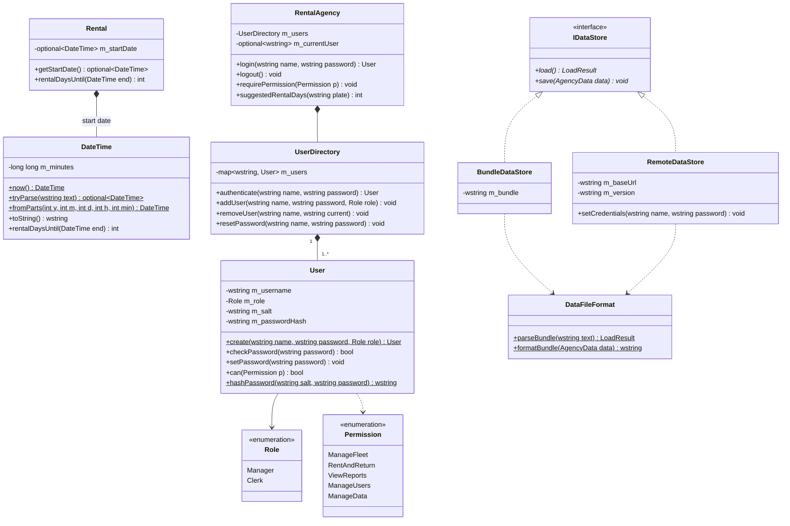
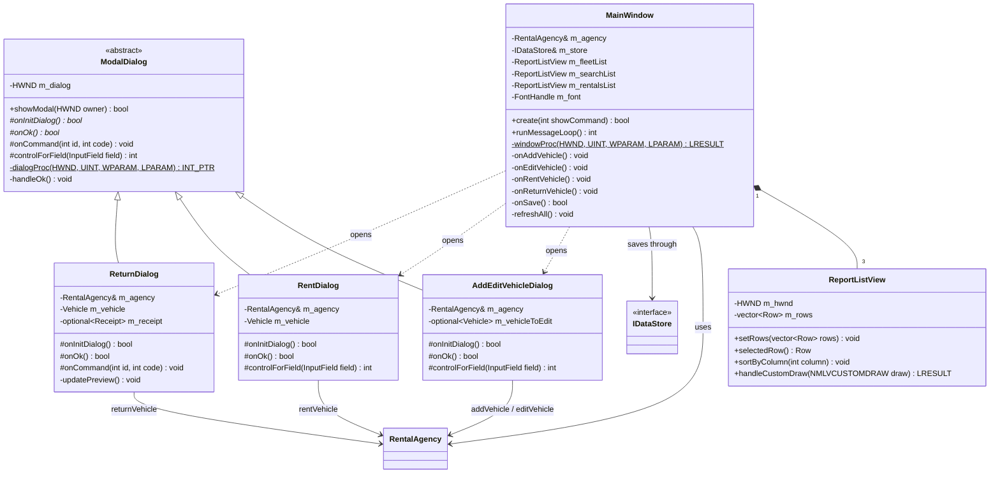

# Car Rental Management System

A Windows desktop application written in **C++17** using the **native Win32 API and Common Controls**.
It does not use Qt, MFC, C++/CLI or any third-party library.
It builds with a default Visual Studio 2022 "Desktop development with C++" installation.

It manages a fleet of rental vehicles. You can add and edit vehicles, search for available ones by model, rent and return vehicles (the return prints a receipt) and track the cumulative rental revenue. All data is stored in UTF-8 text files next to the `.exe`.

Additional features:

- **Rental start dates.** Every rental records when it started, and the number of rental days is calculated automatically on return (every started 24 hours counts as one day). The clerk can still correct it.
- **User accounts with roles.** Everybody logs in. A **Manager** may do everything; a **Clerk** may only rent and return vehicles. Passwords are stored only as salted, iterated SHA-256 hashes.
- **Shared online database.** Several users, in the desktop program and on the website, can work with the same data stored on the server. Changes made at the same time by two users are detected (optimistic locking), so nobody silently overwrites another user's work.
- **Unit tests with GoogleTest**, in addition to the built-in self-test. They run automatically on every deployment.

---

## 1. Project structure

```
Car_Rental_Management_System/
├── CarRentalSystem.sln              ← open this in Visual Studio 2022
├── README.md                        ← this file (setup, OOP explanation, UML)
├── TEST_CHECKLIST.md                ← step-by-step demonstration / test plan
├── tests/                           ← GoogleTest unit tests (UnitTests.vcxproj)
├── api/                             ← server functions of the shared online database
├── web/                             ← web version (same C++ compiled to WebAssembly)
└── CarRentalSystem/
    ├── CarRentalSystem.vcxproj      ← project (C++17, Unicode, /W4, Windows subsystem)
    ├── CarRental.rc, Resource.h     ← menu, accelerators, dialog templates, version info
    │
    │   Business logic (no GUI code)
    ├── Money.h/.cpp                 ← value class, integer cents
    ├── Renter.h/.cpp                ← name + phone, validated
    ├── Rental.h/.cpp                ← Renter + agreed rate, calculateCharge()
    ├── Receipt.h/.cpp               ← data of a completed rental
    ├── RentalRecord.h/.cpp          ← rental history entry: number + return date + Receipt
    ├── RentalStatistics.h/.cpp      ← reports: utilization, averages, revenue by model, top vehicles
    ├── Vehicle.h/.cpp               ← plate, model, rate, status, optional<Rental>
    ├── RentalAgency.h/.cpp          ← owns the fleet + revenue, one method per use case
    ├── RentalExceptions.h/.cpp      ← exception hierarchy
    ├── Validation.h/.cpp            ← all validation rules in one place
    ├── TextUtils.h/.cpp             ← trimming, case-insensitive compare, UTF-8
    ├── BusinessRuleSelfTest.h/.cpp  ← Help > Run Business Rule Self-Test
    ├── DateTime.h/.cpp              ← value class: date/time, rental days calculation
    ├── User.h/.cpp                  ← user account, roles and permissions
    ├── UserDirectory.h/.cpp         ← all accounts, login, account rules
    ├── Sha256.h/.cpp                ← SHA-256 for the password hashes
    │
    │   Persistence
    ├── IDataStore.h/.cpp            ← abstract interface (pure virtual load/save)
    ├── TextFileDataStore.h/.cpp     ← vehicles.txt / revenue.txt implementation
    ├── InMemoryDataStore.h/.cpp     ← second implementation (used by the self-test)
    ├── DataFileFormat.h/.cpp        ← reads/writes the text format (shared by all stores)
    ├── BundleDataStore.h/.cpp       ← all data in one text (web version)
    ├── RemoteDataStore.h/.cpp       ← shared online database over HTTPS (WinHTTP)
    │
    │   GUI
    ├── main.cpp                     ← wWinMain: wires the layers together
    ├── MainWindow.h/.cpp            ← menu, tabs, lists, status bar
    ├── ModalDialog.h/.cpp           ← abstract base class of all dialogs
    ├── AddEditVehicleDialog.h/.cpp
    ├── RentDialog.h/.cpp
    ├── ReturnDialog.h/.cpp
    ├── LoginDialog.h/.cpp
    ├── UsersDialog.h/.cpp           ← Users > Manage Users (Managers only)
    ├── ChangePasswordDialog.h/.cpp
    ├── ReportListView.h/.cpp        ← sortable, coloured ListView wrapper
    ├── GuiUtils.h/.cpp              ← fonts (RAII), DPI scaling, helpers
    ├── Win32Include.h
    │
    └── data/
        ├── vehicles.txt             ← sample fleet (8 vehicles)
        ├── revenue.txt              ← sample revenue (3250.00)
        ├── history.txt              ← sample rental history (4 rentals = 3250.00)
        └── vehicles_with_errors.txt ← for demonstrating load validation
```

---

## 2. Building and running in Visual Studio 2022

### Option A: open the included solution (recommended)

1. Install **Visual Studio 2022** with the **"Desktop development with C++"** workload. The default components are enough: MSVC v143 and a Windows 10/11 SDK.
2. Double-click **`CarRentalSystem.sln`**.
3. Choose the configuration **Debug** and the platform **x64** in the toolbar.
4. Press **F5** (or Ctrl+F5 to run without the debugger).

The project is already configured with:
- C++17
- Unicode
- Warning level 4
- Subsystem Windows
- `comctl32.lib` and `uxtheme.lib`
- the `.rc` file

A **post-build step** copies `data\vehicles.txt`, `data\revenue.txt` and `data\history.txt` next to the `.exe` (for example `x64\Debug\`). It copies them **only if they are not there yet**, so your saved data is never overwritten. To start again from the sample data, delete `vehicles.txt`, `revenue.txt` and `history.txt` from the output folder and build again.

> If Visual Studio asks to "Retarget Projects" (for example because a different Windows SDK version is installed), click **OK**.

### Option B: create the project yourself, step by step

1. **File > New > Project…** → choose **"Empty Project"** (C++ / Windows / Console) → name it `CarRentalSystem` → **Create**.
   (Don't pick the "Windows Desktop Application" template. It generates its own `.cpp`/`.rc` files that would conflict.)
2. Copy every `.h`, `.cpp`, `CarRental.rc` and `Resource.h` from the `CarRentalSystem` folder into the new project folder.
3. In **Solution Explorer**, right-click the project → **Add > Existing Item…** → select all `.h`, `.cpp` files and **`CarRental.rc`** → **Add**.
   - If double-clicking `CarRental.rc` opens the graphical Resource View, that is fine. To see the text, right-click it → **View Code**. Avoid saving it from the resource editor, because the editor rewrites the file.
4. Right-click the project → **Properties**. At the top, select **Configuration: All Configurations** and **Platform: All Platforms**. Then set:

   | Page | Setting | Value |
   |---|---|---|
   | Configuration Properties > General | C++ Language Standard | **ISO C++17 Standard (/std:c++17)** |
   | Configuration Properties > Advanced | Character Set | **Use Unicode Character Set** |
   | C/C++ > General | Warning Level | **Level4 (/W4)** |
   | C/C++ > Preprocessor | Preprocessor Definitions | add `WIN32_LEAN_AND_MEAN;NOMINMAX;` (optional, also set in `Win32Include.h`) |
   | Linker > System | SubSystem | **Windows (/SUBSYSTEM:WINDOWS)** |
   | Linker > Input | Additional Dependencies | add `comctl32.lib;uxtheme.lib;` (also requested by `#pragma comment` in `main.cpp`) |

5. **Build > Build Solution** (Ctrl+Shift+B).
6. Copy `data\vehicles.txt` and `data\revenue.txt` into the folder that contains the `.exe` (for example `x64\Debug\`). Without them the program starts with an empty fleet and 0.00 revenue.
7. Press **F5**.

The Common Controls v6 manifest (Visual Styles) comes from a `#pragma comment(linker, "/manifestdependency:…")` in `main.cpp`. Per-Monitor V2 DPI awareness is enabled at the start of `wWinMain`. No extra manifest file is needed.

---

## 3. Using the program

| Tab | What you can do |
|---|---|
| **Fleet** | See all vehicles (green = Available, orange = Rented). **Find vehicle** searches plate and model; the filter shows All / Available / Rented. **Add Vehicle…** adds a vehicle. **Edit Selected…** (or a double-click, or Enter) edits an *available* vehicle's model and rate. **Remove Selected…** (or the Delete key) removes an *available* vehicle after confirmation; its completed rentals stay in the history. Click a column header to sort. |
| **Search & Rent** | Type part of a model (for example `cor`) and the list filters as you type. Only available vehicles are shown. **Rent Selected…** opens the rent dialog. |
| **Rentals & Returns** | Shows the rented vehicles and the cumulative revenue. **Return Selected…** asks for the number of days, shows a live charge preview and then prints a receipt. |
| **Rental History** | Every completed rental with its receipt number, return date and charge. Search by plate, model, renter or phone; double-click to show the receipt again. |
| **Reports** | Fleet utilization, income from active rentals, completed rentals, total and average charge, average rental length, revenue by model and the most-rented vehicles (calculated by the C++ `RentalStatistics` class). |

- **Menu:**
  - File > Save (Ctrl+S), File > Reload (Ctrl+R), File > Log Out / Switch User, File > Exit.
  - Users > Manage Users (Managers only), Users > Change My Password.
  - Help > Run Business Rule Self-Test, Help > About.
- **Keyboard:**
  - Tab / Shift+Tab move between controls.
  - Ctrl+Tab / Ctrl+Shift+Tab switch tabs.
  - Ctrl+F jumps to the search box.
  - Enter runs the main action of the current tab.
  - In dialogs, Enter = OK and Esc = Cancel.
- **Status bar:** total vehicles | available | rented | cumulative revenue | result of the last action.
- **Unsaved changes:** the title bar shows `*`. On exit you are asked **"Save changes?"** (Yes / No / Cancel).

### Data file format

`vehicles.txt` (UTF-8, one line per vehicle; the rental fields are empty for Available vehicles):

```
plate|model|dailyRate|status|renterName|phone|agreedRate|startDate
ABC-123|Toyota Corolla|150.00|Available||||
COR-202|Toyota Corolla|155.00|Rented|John Smith|+1 555-0100|140.00|2026-11-08 10:15
```

The last field (rental start date, `YYYY-MM-DD HH:MM`) was added later. Lines with 7 fields (no start date) are still accepted.

`revenue.txt`: one line with the cumulative revenue, for example `3250.00`.

`history.txt` (UTF-8, one line per completed rental, written automatically on every return):

```
number|returnedOn|plate|model|renterName|phone|agreedRate|days|charge|startedOn
1|2026-10-03 09:30|ABC-123|Toyota Corolla|Emma Wilson|+1 555-0142|150.00|4|600.00|2026-09-29 10:00
```

`users.txt` (one line per account; the password itself is never stored):

```
username|role|salt|passwordHash
manager|Manager|0123456789abcdef|91da3dc2b70b3770a8f13ab5175fd8c189a75a1df26d5ac91e46cf88b490511a
```

If `users.txt` is missing (or contains no Manager), the two default accounts are created: **manager / manager123** (Manager) and **clerk / clerk123** (Clerk). The program reminds you to change these passwords.

Every history line is validated with the same rules as manual entry. The receipt number must be unique, the date must be `YYYY-MM-DD HH:MM`, and the charge must equal agreed rate × days; otherwise the line is skipped with a warning. The four sample rentals add up to exactly the sample revenue of 3,250.00.

### Rental history

Every time a vehicle is returned, `RentalAgency::returnVehicle()` archives the rental as a `RentalRecord`: a sequential **receipt number**, the **return date and time**, and the full `Receipt`.
- The **Rental History** tab lists every completed rental (No., Returned, Plate, Model, Renter, Telephone, Rate, Days, Charge). You can sort it by any column and search it by plate, model, renter or telephone, and it shows the number of rentals and the total charged.
- Double-click a record (or press Enter) to show its receipt again.
- The receipt shown after a return now includes its receipt number and date.

Every line is validated with the **same rules as manual entry** when it is loaded. Bad lines are skipped and listed in one summary warning. Examples of bad lines: malformed lines, duplicate plates, invalid rates, and Rented vehicles without renter information. Saving writes a temporary file and then renames it, so a crash can never leave a half-written file.

### User accounts and roles

Before the main window opens, the **Log In** dialog asks for a user name and password. The title bar then shows who is logged in, for example `Car Rental Management System  -  anna (Clerk)`.

| Operation | Manager | Clerk |
|---|:---:|:---:|
| View the fleet, search, view rentals and the rental history | ✔ | ✔ |
| Rent and return vehicles | ✔ | ✔ |
| Add, edit and remove vehicles | ✔ | ✘ |
| Reports | ✔ | ✘ |
| Manage user accounts (add, delete, reset passwords) | ✔ | ✘ |

- The rules are enforced in the **business layer**: `RentalAgency` calls `requirePermission()` at the start of every protected use case and throws `AccessDeniedException`. The GUI only greys out the buttons a user may not use.
- Everybody can change their own password (Users > Change My Password).
- You cannot delete your own account, and the last Manager account can never be deleted, so nobody can lock themselves out.
- Passwords are hashed as `h = SHA256(salt ":" password)`, then 999 more times `h = SHA256(salt ":" h)`, with a random 16-character salt per account. The same calculation is used by the online database, so the same password works everywhere.

### Rental start dates and automatic rental days

- `RentalAgency::rentVehicle()` stores the current date and time in the `Rental` (class `DateTime`).
- The **Rentals & Returns** tab shows a **Rented Since** column.
- The **Return** dialog shows "Rented since" and fills in the rental days automatically: every started 24 hours counts as one day, with a minimum of 1 day. For example, rented on 2026-11-08 at 10:15 and returned on 2026-11-11 at 12:00 gives **4 days**. The value can still be changed before clicking OK.
- The receipt and the rental history show the start date as well.
- `DateTime` validates the calendar (month lengths and leap years), so an impossible date such as `2026-02-30` is rejected when the files are loaded.

### Shared online database

Normally the data is stored in text files next to the `.exe`. To let several users work with the **same data**, the system can use a shared online database instead:

1. **Server:** the website on Vercel includes two small server functions (`api/data.js` and `api/status.js`). They store the data in an **Upstash Redis** database. Connect the database once in the Vercel dashboard: open the project → **Storage** → **Create Database** → **Upstash for Redis** → connect it to the project, then redeploy. Vercel adds the required settings (`KV_REST_API_URL` and `KV_REST_API_TOKEN`) automatically.
2. **Website:** once the database is connected, the website automatically switches to "Shared online database" mode (shown in the top bar). Every user logs in with their own account.
3. **Desktop program:** create a file `server.txt` next to `CarRentalSystem.exe` that contains only the web address of the site, for example `https://your-project.vercel.app`. The program then uses `RemoteDataStore` instead of `TextFileDataStore`. The login is checked by the server. Without `server.txt`, the local text files are used as before.

How it works:
- **Loading** downloads all data. **Saving** (Ctrl+S) uploads it. **File > Reload** (Ctrl+R) downloads the latest data from the other users.
- Every request is authenticated with the user's name and password (HTTPS). The server checks the password against the stored hashes. A Clerk is not allowed to change the user accounts.
- **Concurrent changes:** the server keeps a version number. If somebody else saved since you loaded, your save is refused with *"The shared data was changed by another user after you loaded it. Your changes were NOT saved…"*. Reload, repeat your change, and save again. This is called *optimistic locking*.
- When the online database is still empty, the first Manager who saves uploads the current data (on the desktop, the local files are used as the starting data).

---

## 4. Object-oriented design

### 4.1 Layers

```
 GUI layer           MainWindow, ModalDialog (+3 dialogs), ReportListView
   │  calls methods / catches RentalException
   ▼
 Business layer      RentalAgency → Vehicle → Rental → Renter, Money, Receipt, Validation
   │  through the IDataStore interface only
   ▼
 Persistence layer   IDataStore  ◁──  TextFileDataStore, InMemoryDataStore,
                                       BundleDataStore, RemoteDataStore
                     (all use DataFileFormat for the text format)
```

The business layer contains **no GUI code**: it never shows a message box and does not include any dialog or window header. Every rule is enforced there. The GUI only collects input, calls `RentalAgency` and displays the results or the exception messages.

### 4.2 Where each OOP principle is used

**Encapsulation**
- Every class keeps its data members `private`, and no class has public data fields. `Money` hides its `long long m_cents`. `Vehicle` hides its plate, status and rental, and has **no setters**.
- **Objects enforce their own rules:**
  - `Vehicle::rent()` throws `VehicleNotAvailableException` if the vehicle is already rented.
  - `Vehicle::edit()` throws if the vehicle is rented.
  - `Vehicle::returnVehicle()` throws `VehicleNotRentedException` if it is not rented.
  - The constructors of `Vehicle`, `Renter` and `Rental` validate their arguments, so an invalid object can never exist.
- Invariant of `Vehicle`: *status is Rented ⇔ `std::optional<Rental>` has a value*. Only the class's own methods change these two together, so outside code cannot break the invariant.
- `RentalAgency` returns **copies** (`std::vector<Vehicle>`) from its queries, so callers cannot modify the fleet behind its back.
- `ReportListView` hides all raw `LVM_*` ListView messages behind a small interface.

**Inheritance**
- `IDataStore` (abstract) ← `TextFileDataStore`, `InMemoryDataStore`, `BundleDataStore`, `RemoteDataStore`.
- `std::runtime_error` ← `RentalException` ← `ValidationException`, `DuplicatePlateException`, `VehicleNotFoundException`, `VehicleNotAvailableException`, `VehicleNotRentedException`, `AuthenticationException`, `AccessDeniedException`, `DataStoreException` ← `DataConflictException`.
- `ModalDialog` (abstract) ← `AddEditVehicleDialog`, `RentDialog`, `ReturnDialog`, `LoginDialog`, `UsersDialog`, `ChangePasswordDialog`.
- `AgencyData` ← `LoadResult` (a load result is the data plus the warnings).

**Polymorphism**
- `RentalAgency::loadFrom(IDataStore&)` and `saveTo(IDataStore&)` call the **pure virtual** `load()` and `save()` functions. Which implementation runs is decided **at run time** through the virtual table.
  - `main.cpp` passes a `TextFileDataStore`, or a `RemoteDataStore` when `server.txt` exists.
  - The self-test passes an `InMemoryDataStore`, and the web version a `BundleDataStore`.
  - `RentalAgency` itself did not change when the online database was added: `RemoteDataStore` is simply another implementation of the interface.
- `ModalDialog` uses the **Template Method** pattern:
  - The base class runs the dialog and handles the OK button.
  - It calls the virtual functions `onInitDialog()`, `onOk()`, `onCommand()` and `controlForField()`, which each dialog overrides.
- Exceptions are caught polymorphically:
  - `catch (const ValidationException&)` catches field errors and focuses the bad field.
  - `catch (const RentalException&)` catches every other rule violation in a single handler.

**Abstraction**
- `IDataStore` describes *what* storage does (load, save), not *how*.
- `RentalAgency` offers one method per use case: `addVehicle`, `editVehicle`, `searchAvailableByModel`, `rentVehicle`, `returnVehicle`, `getRentedVehicles`, `getRevenue`.

**Exception handling**
- Business classes **throw**; they never display anything.
- `ModalDialog::handleOk()` catches the exceptions while a dialog is open. It shows the message, **keeps the dialog open** and **focuses the bad field**, using `ValidationException::field()`.
- `MainWindow::handleMessage()` is a central try/catch barrier. No C++ exception can ever travel into Windows code.
- Each operation offers the **strong exception guarantee**: if it fails, nothing changes.
  - `Vehicle::edit()` validates everything before assigning.
  - `Vehicle::returnVehicle()` calculates the charge before clearing the rental.
  - `RentalAgency::loadFrom()` builds the new fleet before replacing the old one.

**Operator overloading (value class)**
- `Money` stores **cents in a `long long`**, never `float`/`double`, so there are no rounding errors: 0.10 + 0.20 is exactly 0.30.
- It provides `operator+`, `+=`, `operator*(int days)`, the comparison operators `== != < <= > >=`, and `operator<<` for streams.
- It throws `std::overflow_error` instead of silently wrapping.

**Modern C++ / RAII**
- There is no raw `new`/`delete` anywhere. Objects live on the stack or in standard containers (`std::map`, `std::vector`, `std::optional`).
- GDI fonts are owned by `Gui::FontHandle`, a `std::unique_ptr` with a custom deleter.
- File streams close automatically.
- `const`-correct getters are used throughout, and objects are passed by `const&`.
- There are no global variables. The `MainWindow` pointer is stored in the window's `GWLP_USERDATA`, and the dialog pointer in `DWLP_USER`.

---

## 5. UML class diagrams

You can paste these Mermaid blocks into <https://mermaid.live> to export them as PNG/SVG for your report. GitHub and VS Code (with a Mermaid extension) also render them directly.

### 5.1 Business logic, persistence and exceptions

```mermaid
classDiagram
    direction TB

    class Money {
        -long long m_cents
        +fromCents(long long cents)$ Money
        +tryParse(wstring text)$ optional~Money~
        +parse(wstring text)$ Money
        +cents() long long
        +isPositive() bool
        +toString() wstring
        +toDisplayString() wstring
        +operator+(Money other) Money
        +operator*(int days) Money
        +operator==(Money other) bool
    }

    class Renter {
        -wstring m_name
        -wstring m_phone
        +Renter(wstring name, wstring phone)
        +getName() wstring
        +getPhone() wstring
    }

    class Rental {
        -Renter m_renter
        -Money m_agreedDailyRate
        +Rental(Renter renter, Money agreedDailyRate)
        +getRenter() Renter
        +getAgreedDailyRate() Money
        +calculateCharge(int days) Money
    }

    class VehicleStatus {
        <<enumeration>>
        Available
        Rented
    }

    class Vehicle {
        -wstring m_plate
        -wstring m_model
        -Money m_dailyRate
        -VehicleStatus m_status
        -optional~Rental~ m_rental
        +Vehicle(wstring plate, wstring model, Money dailyRate)
        +getPlate() wstring
        +getModel() wstring
        +getDailyRate() Money
        +getStatus() VehicleStatus
        +isAvailable() bool
        +getRental() optional~Rental~
        +edit(wstring model, Money dailyRate) void
        +rent(Renter renter, Money agreedDailyRate) void
        +returnVehicle(int days) Receipt
    }

    class Receipt {
        -wstring m_plate
        -wstring m_model
        -wstring m_renterName
        -wstring m_phone
        -Money m_agreedDailyRate
        -int m_days
        -Money m_totalCharge
        +getTotalCharge() Money
        +toDisplayText() wstring
    }

    class RentalRecord {
        -int m_number
        -wstring m_returnedOn
        -Receipt m_receipt
        +getNumber() int
        +getReturnedOn() wstring
        +getReceipt() Receipt
        +matches(wstring query) bool
        +currentTimestamp()$ wstring
        +isValidTimestamp(wstring text)$ bool
    }

    class RentalStatistics {
        -size_t m_vehicleCount
        -size_t m_rentedCount
        -Money m_totalCharged
        -vector~ModelSummary~ m_byModel
        -vector~VehicleSummary~ m_topVehicles
        +RentalStatistics(RentalAgency agency)
        +getUtilizationPercent() int
        +getActiveDailyIncome() Money
        +getAverageCharge() Money
        +getAverageDaysText() wstring
        +getRevenueByModel() vector~ModelSummary~
        +getTopVehicles() vector~VehicleSummary~
    }

    class RentalAgency {
        -map~wstring, Vehicle~ m_fleet
        -Money m_revenue
        -bool m_modified
        +addVehicle(wstring plate, wstring model, Money rate) Vehicle
        +editVehicle(wstring plate, wstring model, Money rate) void
        +removeVehicle(wstring plate) void
        +searchFleet(wstring query, StatusFilter filter) vector~Vehicle~
        +searchAvailableByModel(wstring query) vector~Vehicle~
        +rentVehicle(wstring plate, Renter renter, Money agreedRate) void
        +returnVehicle(wstring plate, int days) Receipt
        +getRentedVehicles() vector~Vehicle~
        +getRevenue() Money
        +getAllVehicles() vector~Vehicle~
        +getHistory() vector~RentalRecord~
        +searchHistory(wstring query) vector~RentalRecord~
        +getLastRecord() RentalRecord
        +totalCharged(vector~RentalRecord~ records)$ Money
        +hasUnsavedChanges() bool
        +loadFrom(IDataStore store) vector~wstring~
        +saveTo(IDataStore store) void
    }

    class IDataStore {
        <<interface>>
        +load()* LoadResult
        +save(vector~Vehicle~ vehicles, Money revenue, vector~RentalRecord~ history)* void
        +describeLocation()* wstring
    }

    class TextFileDataStore {
        -path m_directory
        +load() LoadResult
        +save(AgencyData data) void
        +describeLocation() wstring
        -parseVehicleLine(wstring line)$ Vehicle
        -formatVehicleLine(Vehicle vehicle)$ wstring
        -parseHistoryLine(wstring line)$ RentalRecord
        -formatHistoryLine(RentalRecord record)$ wstring
    }

    class InMemoryDataStore {
        -vector~Vehicle~ m_vehicles
        -Money m_revenue
        -vector~RentalRecord~ m_history
        +load() LoadResult
        +save(vector~Vehicle~ vehicles, Money revenue, vector~RentalRecord~ history) void
        +describeLocation() wstring
    }

    class AgencyData {
        +vector~Vehicle~ vehicles
        +Money revenue
        +vector~RentalRecord~ history
        +vector~User~ users
    }
    class LoadResult {
        +vector~wstring~ warnings
    }

    class runtime_error["std::runtime_error"]
    class RentalException {
        -wstring m_message
        +message() wstring
    }
    class ValidationException {
        -InputField m_field
        +field() InputField
    }
    class DuplicatePlateException
    class VehicleNotFoundException
    class VehicleNotAvailableException
    class VehicleNotRentedException
    class DataStoreException

    RentalAgency "1" *-- "0..*" Vehicle : owns
    RentalAgency *-- Money : revenue
    RentalAgency ..> IDataStore : load/save through
    RentalAgency ..> Receipt : returns
    RentalAgency "1" *-- "0..*" RentalRecord : rental history
    RentalRecord *-- Receipt
    RentalStatistics ..> RentalAgency : reads (const)
    Vehicle "1" *-- "0..1" Rental : active rental
    Vehicle --> VehicleStatus
    Vehicle *-- Money : daily rate
    Vehicle ..> Receipt : creates
    Rental *-- Renter
    Rental *-- Money : agreed rate
    IDataStore <|.. TextFileDataStore
    IDataStore <|.. InMemoryDataStore
    IDataStore ..> LoadResult
    AgencyData <|-- LoadResult

    runtime_error <|-- RentalException
    RentalException <|-- ValidationException
    RentalException <|-- DuplicatePlateException
    RentalException <|-- VehicleNotFoundException
    RentalException <|-- VehicleNotAvailableException
    RentalException <|-- VehicleNotRentedException
    RentalException <|-- DataStoreException
```



*Not shown, to keep the diagram readable: `Money` also has `+=`, `!=`, `<`, `<=`, `>`, `>=`, and a free `operator<<(wostream&, Money)`. `Validation` and `TextUtils` are namespaces of stateless helper functions.*

### 5.2 Users, dates and the additional data stores



### 5.3 GUI layer



---

## 6. Validation rules (all enforced in the business layer)

| Field | Rule |
|---|---|
| License plate | Not empty, max 15 characters. ASCII letters, digits and `-` only, with at least one letter or digit. Unique, compared case-insensitively. Stored in UPPER case. Cannot be changed after creation. |
| Model | Not empty, max 60 characters, no `\|`. |
| Daily rate / agreed rate | Positive (> 0.00), at most 2 decimal places, digits with an optional `.`, max 1,000,000.00. |
| Renter name | Not empty, max 80 characters, no `\|`. |
| Telephone | 6–20 characters: digits, spaces, `-`, and an optional **leading** `+`. Must contain digits. |
| Rental days | Whole positive number 1–3650. Rejects 0, negatives, decimals, letters, empty input and absurdly large values. |
| Rental start date | `YYYY-MM-DD HH:MM`, a real calendar date (month lengths and leap years are checked). |
| User name | 3–20 characters: letters a–z, digits, `.`, `_` and `-`. Stored in lower case and unique. |
| Password | 6–64 characters, no `\|` and no control characters. Stored only as a salted hash. |
| Status rules | A rented vehicle can't be rented again or edited. Only rented vehicles can be returned. |

Deposits, insurance and traffic violations are intentionally **out of scope**.

---

## 7. Web version of the system (Vercel)

The `web/` folder contains the **web version of the system**: `index.html` is the full application (File menu, the four tabs, dialogs, receipts, status bar) and nothing else is published. It runs **the same C++ business logic in the browser**. Data is saved in the browser with File > Save (Ctrl+S); File > Open data files… and File > Download data files read and write the same `vehicles.txt` / `revenue.txt` / `history.txt` format as the desktop program.

- `web/wasm/WebBindings.cpp` is a small C++ bridge. It plays the role of the desktop dialogs, calling `RentalAgency` and catching `RentalException` exactly like `ModalDialog::handleOk()`.
- `web/build.sh` compiles the business classes in `CarRentalSystem/` (`Money`, `Vehicle`, `RentalAgency`, `Validation`, `TextFileDataStore`, …) together with the bridge to WebAssembly using **Emscripten**. Only the Win32 GUI files are left out; the page in `web/index.html` + `web/app.js` replaces them and contains no business rules.
- `TextUtils.cpp` uses the Win32 API on Windows and portable standard C++ elsewhere. No other business file needed any change.
- `vercel.json` tells Vercel to run `web/build.sh` and publish `web/dist/`. Every push to GitHub rebuilds the site from the C++ sources.

- The website has two storage modes. Without a database it keeps the data in the browser (each visitor has their own copy). With the **Upstash Redis** database connected (see *Shared online database* in section 3), all users share the same data.
- `api/data.js` (GET/PUT `/api/data`) checks the user name and password against the stored password hashes, refuses user-account changes by Clerks (403) and refuses a save based on an old version (409).
- During the build, `web/build.sh` also compiles and runs the **GoogleTest unit tests**. If a test fails, the deployment stops and the previous version of the site stays online. The test output is published as `unit-tests.txt`.

**Deploying:** on <https://vercel.com/new>, import this GitHub repository and click **Deploy**. No settings need changing, because `vercel.json` provides them.

---

## 8. Unit tests (GoogleTest)

The `tests/` folder contains about 40 GoogleTest unit tests in four files:

| File | What it tests |
|---|---|
| `MoneyAndValidationTests.cpp` | `Money` parsing, formatting, exact arithmetic and overflow; every validation rule; `DateTime` (parsing, impossible dates, leap years, rental days); SHA-256 standard test vectors |
| `BusinessLogicTests.cpp` | `Vehicle` state rules, `Rental` day calculation, `RentalAgency` use cases (duplicates, search, rent/return, revenue, history, removing vehicles), `RentalStatistics` |
| `UsersAndPersistenceTests.cpp` | password hashing (including a cross-check against the online server's JavaScript implementation), roles and permissions, account rules, the text-file, bundle and in-memory data stores, invalid lines in the data files |
| `SelfTestTests.cpp` | runs the built-in business-rule self-test and requires all 50 checks to pass |

The tests compile the **same `.cpp` files** as the program; nothing is copied.

**In Visual Studio 2022:**
1. Open `CarRentalSystem.sln`. It contains two projects: `CarRentalSystem` (the program) and `UnitTests`.
2. Build the solution. Visual Studio downloads GoogleTest automatically from NuGet (package `Microsoft.googletest.v140.windesktop.msvcstl.static.rt-dyn`). If it does not, right-click the solution and choose **Restore NuGet Packages**.
3. Open **Test > Test Explorer** and click **Run All Tests**. Alternatively, set `UnitTests` as the startup project and press Ctrl+F5 to see the console output.

**Automatically:** every Vercel deployment builds the tests with Emscripten and runs them with Node.js (see `web/build.sh`).
